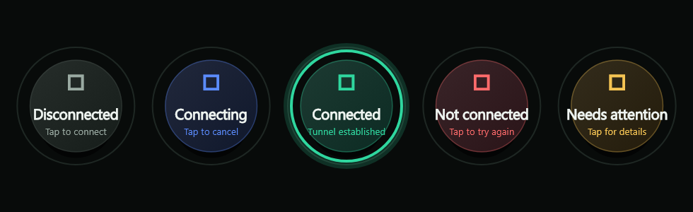
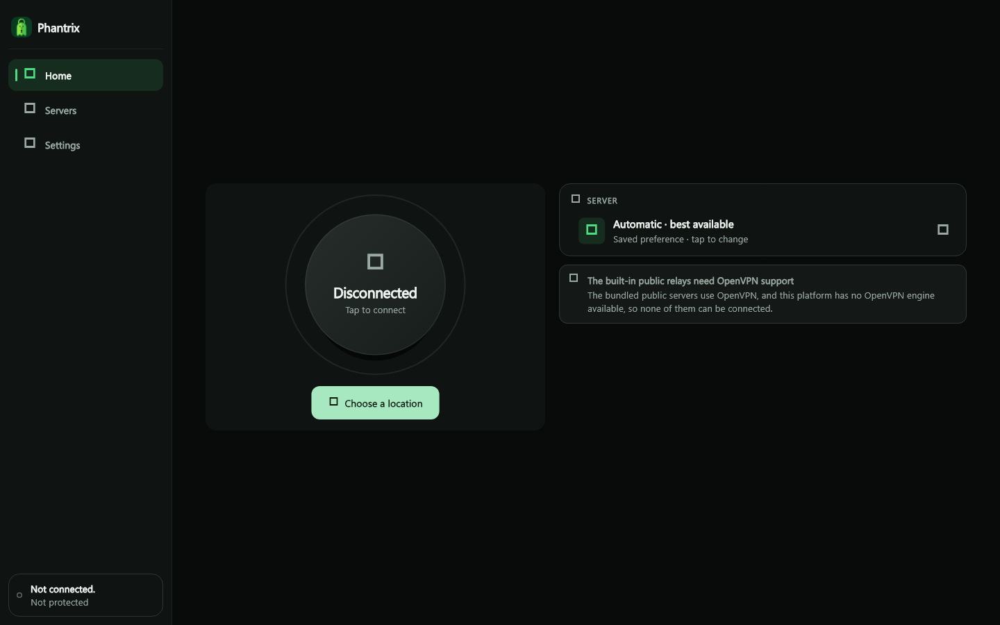
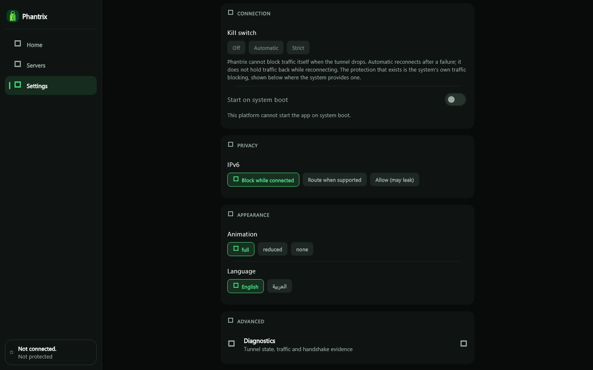

# Phantrix

[](https://github.com/LaymonGames/phantrix-vpn/actions/workflows/verify.yml)
[](https://github.com/LaymonGames/phantrix-vpn/actions/workflows/windows.yml)
[](https://github.com/LaymonGames/phantrix-vpn/actions/workflows/linux.yml)
[](https://github.com/LaymonGames/phantrix-vpn/actions/workflows/android.yml)
[](LICENSE)
[](#المساهمة)

**العربية** · [English](README.md)

<div dir="rtl">

فانتريكس عميل VPN مجاني وبلا حساب، مكتوب بـFlutter، لبروتوكول **OpenVPN**. لا تسجيل ولا اشتراك ولا أي تحليلات. وهو عميل فقط: أنت من يجلب الخادم — خادمك الخاص، أو خادم مزوّدك، أو مرحّل عام من قائمة VPN Gate المدمجة.

شيفرة فانتريكس نفسه مرخّصة تحت **GPL-3.0-only** (انظر [الترخيص](#الترخيص)).

> **الحالة: مبكّرة، ومعظمها غير متحقَّق منه.** شوهد نفق OpenVPN يعمل مرة واحدة على ويندوز. اقرأ [حالة المنصات](#حالة-المنصات) قبل الاعتماد عليه.

## الميزات

- **لا شيء للتسجيل فيه.** بلا حساب، بلا اشتراك، وبلا أي مكتبة تحليلات.
- **OpenVPN عبر المحرّك الرسمي.** فانتريكس لا ينفّذ أي تعمية VPN بنفسه؛ وعلى ويندوز يعمل المحرّك كعملية مساعدة منفصلة مرفوعة الصلاحيات.
- **مرحّلات عامة مدمجة.** القائمة المدمجة هي VPN Gate ويشغّلها متطوّعون؛ وفانتريكس لا يملك خوادم خاصة به.
- **حالة صادقة.** لا تظهر كلمة "متصل" إلا بعد أن يُكمل المحرّك المصافحة ويتغيّر عنوانك العام؛ وكل ما دون ذلك يُقال بصراحة.
- **الإنجليزية والعربية**، مع قلب التخطيط للكتابة من اليمين إلى اليسار.

## لقطات الشاشة

حالات زرّ الاتصال الخمس:



التطبيق على سطح المكتب، والإعدادات مع اختيار اللغة:





هذه اللقطات يرسمها اختبار الواجهة (`test/ui_screenshots_test.dart`) وليست مأخوذة من نفق حيّ.

---

## البدء السريع (البناء من المصدر)

هذه الخطوات خاصة بـ**ويندوز**، المنصة الوحيدة التي يمكن فيها الاتصال بالمرحّلات المدمجة من VPN Gate. أما بقية المنصات فمشروحة في [BUILDING.md](BUILDING.md).

**تحتاج إلى:** Flutter (3.47.0 أو أحدث)، وVisual Studio 2022 مع حزمة عمل "Desktop development with C++".

من جذر المستودع، في طرفية ويندوز عادية:

```powershell
flutter pub get

# Downloads the OpenVPN engine and the wintun driver, and verifies their
# pinned SHA-256 hashes. Required for OpenVPN and the VPN Gate relays.
powershell -NoProfile -ExecutionPolicy Bypass -File tools\fetch_openvpn_bundle.ps1

flutter run -d windows            # or: flutter build windows --release
```

ملاحظات:

- **لا تتخطَّ خطوة التنزيل.** فمحرّك OpenVPN مقصودٌ إبقاؤه خارج git (كل ما تحت `packages/phantrix_platform/windows/bundle/` متجاهَل). نسخة بلا التنزيل تُبنى، لكن التطبيق يُبلّغ أن OpenVPN غير متاح ولا يستطيع الاتصال بالمرحّلات، فيبدو الأمر وكأن "لا شيء يحدث" عند الضغط على "اتصال".
- إن كنت قد بنيت قبل التنزيل، نفّذ `flutter clean` ثم ابنِ من جديد ليلتقط CMake الملفات الجديدة.
- لإعادة فحص الملفات المنزَّلة دون تنزيل أي شيء، أضف `-VerifyOnly` إلى أمر التنزيل.
- الأمر يستخدم PowerShell المرفق مع ويندوز؛ ولا حاجة إلى PowerShell 7 (`pwsh`).
- اتصالات OpenVPN تطلب موافقة المسؤول (نافذة UAC) لأن المحرّك يعمل في مساعد منفصل مرفوع الصلاحيات؛ أما التطبيق نفسه فليس مرفوعًا.

## الاستخدام

- **OpenVPN** هو البروتوكول الوحيد، وعلى ويندوز وحده. اختر مرحّلًا من قائمة VPN Gate المدمجة؛ ويُتحقَّق من الملف التعريفي قبل أن يراه المحرّك.
- تُعرض الخوادم مع بلدانها، و**اختر موقعًا** يتذكّر موقعك. ويمشي التطبيق على قائمة المرحّلات المرتّبة حتى يقبل أحدها الاتصال، ويقول على أيّ مرحّل استقرّ.

لا يقول فانتريكس **"متصل"** إلا بعد أن يؤكّد المحرّك إتمام المصافحة **و**تغيّر عنوانك العام. وإلا فإنه يوضّح سبب عدم الاتصال بدل إظهار علامة خضراء.

---

## حالة المنصات

| المنصة | المحرّك الذي يستطيع التطبيق استخدامه | ما تمّ التحقق منه |
| --- | --- | --- |
| ويندوز | ملفات OpenVPN 2.6 الرسمية + wintun، تعمل كعملية مساعدة منفصلة | OpenVPN: شوهد نفق حيّ واحد لمدة 6.5 دقائق وتغيّر عنوان الخروج (`docs/evidence/openvpn/`) |
| أندرويد | لا شيء. لا محرّك على أندرويد — فـOpenVPN لا يمكن شحنه هناك، وخلفية WireGuard أُزيلت — لذا يرفض التطبيق كل مرحّل مع توضيح | مُسجَّل: اختبارات التطبيق تمرّ على محاكي أندرويد 14، قبل أن يصبح التطبيق OpenVPN-only |
| لينكس | لا شيء | يُبنى في CI. ولم يُشغَّل قط على نظام حيّ |
| macOS / iOS | لا شيء | شيفرة Apple موجودة في `packages/phantrix_platform/apple/` لكنها لم تُصرَّف قط وليست هدف بناء |
| الويب | لا شيء | المتصفح لا يستطيع تمرير حركة النظام. التطبيق يُبنى، وفشل "اتصال" فيه واضح ومقصود |

"المحرّك الرسمي" يعني أن فانتريكس يستخدم محرّك المنبع ولا ينفّذ أي تعمية VPN بنفسه. وهذا ليس ادعاءً بأن نفقًا قد تمّ التحقق منه.

مرحّلات VPN Gate العامة تنشر ملفات تعريف OpenVPN فقط، لذا تُعرض على أندرويد ولينكس لكن لا يمكن الاتصال بها. والمرحّلات يديرها متطوّعون وقد لا تكون متاحة من شبكتك.

إصدارات أندرويد التنزيلية **موقّعة بمفتاح تصحيح** ما لم تقدّم مفتاح رفع خاصًا بك؛ انظر [BUILDING.md](BUILDING.md).

## ما تفعله VPN وما لا تفعله

VPN يخفي حركتك عن الشبكة المحلية وعن مزوّد خدمة الإنترنت، ويُظهر للمواقع عنوان الخادم بدل عنوانك. لكنه **لا** يجعلك مجهول الهوية: فمشغّل خادم الخروج يرى الحركة الخارجة منه، وفي المرحّلات العامة يكون ذلك المشغّل متطوّعًا مجهولًا. كذلك لا يحمي حساباتك ولا جهازك ولا يحميك من التتبّع على مستوى التطبيقات.

ومن الحدود الأخرى الجديرة بالمعرفة: مفتاح الإيقاف الصارم مُبلَّغ عنه كغير مدعوم على أندرويد، ويُحجب IPv6 افتراضيًا.

## الخصوصية

لا حساب، ولا مكتبة تحليلات، ولا مُبلِّغ أعطال. يجلب التطبيق قائمة خوادم VPN Gate ويتحقق من عنوانك العام (عبر ipify وخدمة `checkip` من أمازون) للتأكد من النفق. راجع [PRIVACY.md](PRIVACY.md) لمعرفة ما يُخزَّن بالضبط وكيف تحذفه.

---

## التطوير

```bash
flutter pub get
flutter analyze
flutter test

cd packages/phantrix_core && dart pub get && dart test
```

بعد أي تغيير في التبعيات، أعد توليد قائمة التراخيص داخل التطبيق وأضف الناتج إلى الالتزام:

```bash
dart run tools/generate_third_party_notices.dart
```

البنية: `lib/` (واجهة Flutter)، و`packages/phantrix_core/` (تحليل البروتوكولات والتحقق والاكتشاف وآلة الحالة)، و`packages/phantrix_platform/` (شيفرة النفق الأصلية لكل منصة). انظر [ARCHITECTURE.md](ARCHITECTURE.md).

## الوثائق

| الملف | يغطّي |
| --- | --- |
| [BUILDING.md](BUILDING.md) | سلاسل الأدوات وخطوات البناء لكل منصة |
| [ARCHITECTURE.md](ARCHITECTURE.md) | تنظيم الحزم وجسر المنصات |
| [SECURITY.md](SECURITY.md) | نموذج التهديد وقواعد التحقق والإبلاغ عن ثغرة |
| [PRIVACY.md](PRIVACY.md) | ما يُخزَّن وما لا يُجمَع |
| [CONTRIBUTING.md](CONTRIBUTING.md) | سير العمل وقائمة فحص طلبات الدمج |
| [THIRD_PARTY_LICENSES.md](THIRD_PARTY_LICENSES.md) | التبعيات والمكوّنات المضمّنة مع تراخيصها |
| [docs/LICENSING_AUDIT.md](docs/LICENSING_AUDIT.md) | مراجعة التوافق مع GPL-3.0 |
| [docs/EVIDENCE.md](docs/EVIDENCE.md) | ما تمّ التحقق منه، وكيف، وما بقي مفتوحًا |

## المساهمة

المساهمات مرحّب بها — أرسل طلب دمج ببساطة. واقرأ [CONTRIBUTING.md](CONTRIBUTING.md) أولًا: إنه قصير، وقاعدته الصارمة الوحيدة هي الصدق نفسه الذي يحاول هذا الملف الالتزام به — لا يُوصف شيء بأنه يعمل قبل أن يُشاهَد يعمل.

ومن الطرق الصغيرة المفيدة: شغّله على منصة لم يجرّبها أحد وقل ما حدث؛ أخبرنا عندما يتوقف مرحّل عن الاستجابة؛ حسّن العربية؛ أو شدّد جملة أعلاه تدّعي أكثر مما تفعله الشيفرة. والبلاغات عن توثيق يبالغ في الحماية تُعامَل كقضايا عادية.

## الترخيص

شيفرة فانتريكس الأصلية مرخّصة تحت **GNU General Public License v3.0 only** (`GPL-3.0-only`). انظر [LICENSE](LICENSE) لنص الترخيص و[COPYRIGHT](COPYRIGHT) للإشعار. والترخيص يخص الشيفرة المكتوبة باستقلال؛ أما شيفرة الأطراف الثالثة والمقتبسة فتبقى بترخيصها، وهي مسرودة في [THIRD_PARTY_LICENSES.md](THIRD_PARTY_LICENSES.md) وداخل التطبيق تحت **الإعدادات ← حول، التراخيص والاعتمادات**.

- **حزمة ويندوز:** محرّك OpenVPN 2 المجتمعي (GPL-2.0) يعمل كعملية منفصلة غير معدّلة، وهذا تجميع لا عمل مشترك. ومشغّل wintun تحت ترخيص WireGuard LLC للثنائيات الجاهزة، ويجب أن يبقى غير معدّل ومقترنًا بـOpenVPN. لا شيء منهما مضمَّن في هذا المستودع؛ بل يُنزَّلان عبر `tools/fetch_openvpn_bundle.ps1`.
- **أندرويد:** لا يوجد محرّك OpenVPN، لأن المحرّك الوحيد المتاح (ics-openvpn) بترخيص GPL-2.0-only ولا يمكن دمجه مع شيفرة GPL-3.0. لا تُضِفه، ولا أي شيفرة GPL-2.0-only أخرى، إلى بناء أندرويد.

هذه مراجعة هندسية وليست نصيحة قانونية.

</div>
