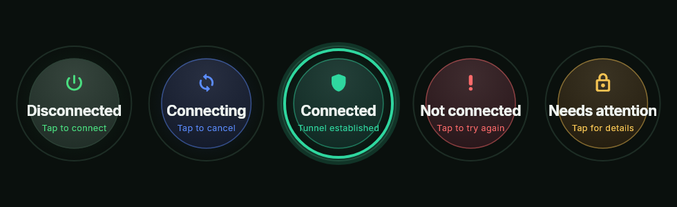
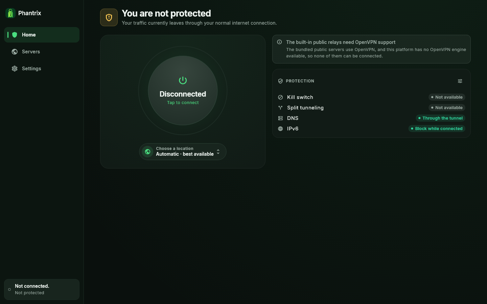
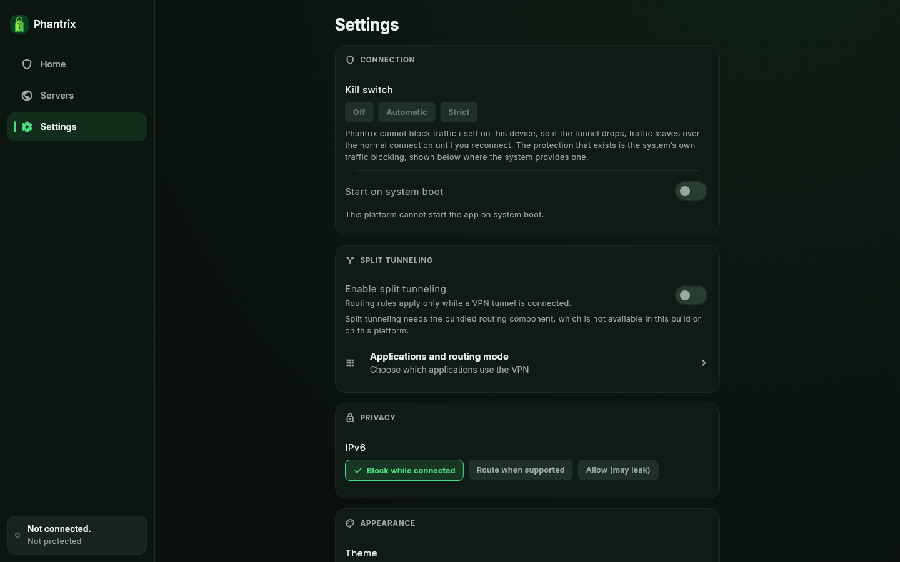
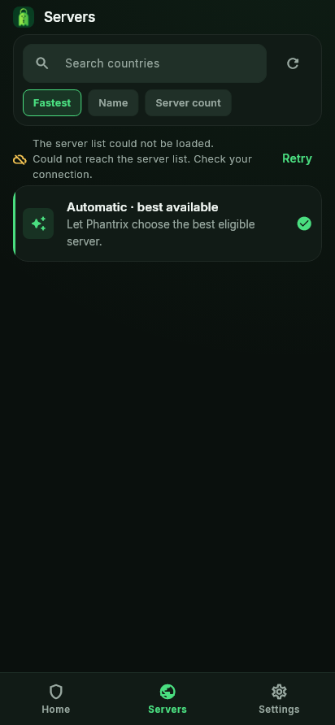
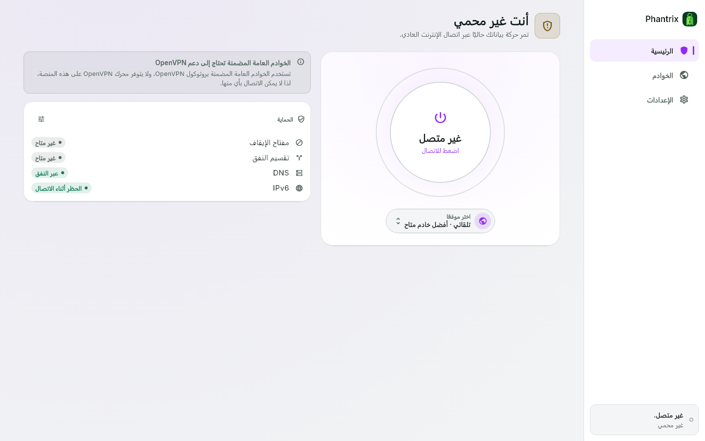

# Phantrix

[](https://github.com/LaymonGames/phantrix-vpn/actions/workflows/verify.yml)
[](https://github.com/LaymonGames/phantrix-vpn/actions/workflows/windows.yml)
[](https://github.com/LaymonGames/phantrix-vpn/actions/workflows/linux.yml)
[](https://github.com/LaymonGames/phantrix-vpn/actions/workflows/android.yml)
[](LICENSE)
[](#contributing)

**English** | [العربية](README.ar.md)

Phantrix is a free VPN client for **OpenVPN**, built with Flutter. There is no
account to create, no email address to give, and no subscription. It is a
client only: it ships no servers, and the relay list comes from VPN Gate, a
network of volunteer-run public relays.

The app's own code is licensed under **GPL-3.0-only** (see [LICENSE](LICENSE)).

> **Status: early.** A live OpenVPN tunnel was observed working on Windows in
> October 2026. The Windows-only features added after that check (kill switch,
> split tunnelling, immediate stop) compile and pass the test suite, but have
> not been run against a real connection yet. Read
> [Platform status](#platform-status) before relying on any of it.

## Features

**Connection**

- OpenVPN through the official upstream engine. Phantrix implements no VPN
  cryptography itself. On Windows the engine runs in a separate helper process
  that asks for administrator rights when a tunnel starts.
- Public relays from VPN Gate, fetched at runtime and cached on disk. Phantrix
  runs no servers of its own.
- Automatic or manual location. Automatic tries the top-ranked relays in turn
  and reports which location it settled on. A country you pick is remembered
  across restarts.
- One control for the whole connection: tap to connect, tap while connecting
  to cancel, tap while connected to disconnect. Switching servers stops the old
  tunnel first.
- Stopping is immediate. The helper gives the engine 250 ms to exit, then ends
  the process. The tunnel adapter and its routes disappear with it.
- Reconnects by itself when the network changes, inside the same time limit as
  a normal attempt; a dead network ends in "not connected" with a reason, not
  in "Reconnecting" forever.
- Honest state. "Connected" appears only after the engine reports a handshake
  and your public address has changed. Anything else is said explicitly.
- Session panel with duration and transferred bytes while a tunnel is starting
  or up.

**Protection on Windows**

- Kill switch with three modes: Off, Automatic, Strict. Windows Filtering
  Platform rules; the local network and DHCP stay reachable.
- Strict keeps blocking after Disconnect. Closing the app lifts the block in every mode. Local printers and other LAN devices stay reachable.
- An "Unblock internet" button on the home screen when the kill switch is
  holding traffic with no tunnel up.
- Split tunnelling per application, in either direction: only the selected
  apps use the VPN, or the selected apps bypass it. Applied to a running
  tunnel without reconnecting.
- The app-picker lists installed applications with icons, supports search,
  removal, and adding an `.exe` by hand. Applications that have been
  uninstalled are skipped when the rules are applied.

**Everything else**

- "Am I protected?" checks on the Diagnostics screen, with a verdict per row
  and "Not tested" where nothing was measured.
- English and Arabic, with the layout mirrored for right-to-left.
- System, Light and Dark themes; eight accent presets plus a custom hue;
  animation at Full, Reduced or Off.
- Start with Windows (per-user startup entry; no administrator rights).
- Onboarding with a privacy notice that cannot be skipped.
- Clear local data, with the onboarding flags kept.
- Licenses and credits screen, generated from the dependency inventory.
- No analytics SDK and no crash reporter.

## Screenshots

The five states of the connection control:



The dashboard and the settings screen:





The server list, and the Arabic interface in a light theme:





These are rendered by the UI test harness (`test/ui_screenshots_test.dart`),
not captured from a live tunnel.

---

## Build from source (Windows)

Windows is the only platform where the VPN Gate relays can connect. Other
platforms are covered in [BUILDING.md](BUILDING.md).

**You need:** Flutter 3.47.0 or newer, and Visual Studio 2022 with the
"Desktop development with C++" workload.

From the repository root, in a normal Windows terminal:

```powershell
flutter pub get

# OpenVPN engine and wintun driver, with pinned SHA-256 checks.
powershell -NoProfile -ExecutionPolicy Bypass -File tools\fetch_openvpn_bundle.ps1

# Router used by split tunnelling, also hash-checked.
pwsh -File tools\fetch_singbox_bundle.ps1

flutter run -d windows            # or: flutter build windows --release
```

Notes:

- **Do not skip the fetch steps.** Everything under
  `packages/phantrix_platform/windows/bundle/` is git-ignored. A checkout
  without the OpenVPN bundle still builds, but the app reports OpenVPN as
  unavailable and declines every relay with an explanation. Without the
  sing-box bundle, split tunnelling stays disabled and says why.
- The sing-box script needs PowerShell 7 (`pwsh`). The OpenVPN script runs with
  the PowerShell that ships with Windows.
- Both scripts verify a pinned hash before extracting anything. A binary that
  does not match fails the download instead of reaching your machine.
- To check the downloaded files without downloading anything, add
  `-VerifyOnly` to either script. Add `-Force` to re-download.
- If you built before fetching, run `flutter clean` and build again so CMake
  picks up the new files.
- The tunnel needs administrator approval (a UAC prompt) because the engine
  runs in a separate elevated helper. The app itself is not elevated.

## Using Phantrix

### First run

The welcome screen explains what the app does and shows a privacy notice. The
notice is not optional: a public relay is run by a volunteer who can see the
traffic leaving it, and you should know that before connecting. Accepting it
takes you to the dashboard. It is not shown again, even after clearing local
data.

### Connecting

The orb on the dashboard is the only control you need:

- Tap while disconnected to connect, using the saved location.
- Tap while connecting to cancel. The tunnel process is stopped right away.
- Tap while connected to disconnect.

The dashboard headline tells you the state in words ("You are protected",
"Securing your connection", "Connection failed") and the location the tunnel
uses. The protection summary under it shows the kill switch mode, the
split-tunnel policy and DNS.

### Choosing a location

Tap the location card, or open **Servers**.

- **Automatic** (the default) lets Phantrix choose. It walks the ranked relays
  in order, skips ones that do not answer, and tells you which location was
  used.
- Picking a country restricts the choice to that country. The choice survives
  restarts; **Automatic** clears it.
- The list has a search field, a sort by name or by server count, and a
  **Refresh** button. It is built from the live inventory; there is no
  built-in list of countries with made-up server counts.
- If a refresh fails, the last cached list is shown with a banner saying it is
  the last one loaded. A damaged cache is rebuilt instead of used.
- Relays are volunteer-run and may be unreachable from your network. When one
  is refused, the app says why rather than failing silently.

There is no profile import yet, so every connection uses a VPN Gate relay.

### Kill switch

Settings → **Connection** → **Kill switch**. Windows only.

| Mode | What it does |
| --- | --- |
| Off | No blocking. If the tunnel drops, traffic continues on the normal connection. |
| Automatic | Blocks all internet outside the VPN from the moment you connect until you press Disconnect. If the connection drops, the block stays until you reconnect or unblock. Closing Phantrix lifts it. |
| Strict | Like Automatic, but the block also stays after Disconnect. Closing the app lifts it, as does connecting, pressing Unblock, or switching to Off or Automatic. |

Things worth knowing:

- Strict is never one tap away. A confirmation dialog explains what it means,
  including that local network devices stay reachable and that admin approval
  is needed on Windows.
- Choosing Strict while disconnected blocks traffic immediately. Declining the
  UAC prompt leaves the setting on but shows a message that it is not blocking
  yet.
- The kill switch always allows Phantrix, the VPN engine, the split-tunnel
  router and DHCP, so you can still connect while blocked.
- When no tunnel is up and the kill switch is holding traffic, the home screen
  shows a card with **Unblock internet**. Turning the kill switch Off or
  Automatic also lifts the block. All three need admin approval on Windows.
- If lifting the rules fails, the app says so instead of pretending it worked.
- Closing the app asks for admin approval to lift any rules still in place. If you decline, they stay until you lift them (`phantrix-unblock.exe --release-firewall` as administrator).
- The kill switch works with split tunnelling on. Traffic outside the tunnel
  leaves through the router, and the router process is allowed through.

### Split tunnelling

Settings → **Split tunneling**. Windows only, and only when the sing-box bundle
is present.

1. Turn on **Enable split tunneling**.
2. Open **Applications and routing mode**.
3. Choose a mode:
   - **Only selected apps use VPN**: everything else keeps your normal
     connection.
   - **Selected apps bypass VPN**: everything else uses the tunnel.
4. Tick applications from the list, search for one, or use **Choose an .exe**
   for something that is not listed.

Changes are saved as you make them. While a tunnel is up, edits are sent to it
after a short pause, so ticking five apps applies one policy rather than five.
Leaving the screen sends anything still pending.

Notes:

- **Only selected apps use VPN** with nothing selected would route no traffic
  through the tunnel, so it is not applied. The screen says so.
- Applications that have been uninstalled are kept in the list but skipped
  when rules are applied. A program on a sleeping USB drive is not deleted
  from your selection.
- Windows' DNS client sends every process through one service, so
  per-application DNS cannot be separated. DNS stays on the tunnel while split
  tunnelling is active.
- The router offers IPv6 only when both the tunnel and the physical connection
  have it. Otherwise it answers DNS with IPv4 addresses only and refuses IPv6
  connections, so browsers fall back to IPv4. The trade-off: if only your
  physical network has IPv6, applications outside the tunnel lose IPv6 while
  split tunnelling is on.

### Diagnostics

Settings → **Advanced** → **Diagnostics**, then **Run checks**. The screen
answers "Am I protected?" with one row per question:

- Public IP (a request to an address service; that service learns the address
  being checked, and the screen says so).
- VPN-assigned IP.
- IPv4 and IPv6.
- DNS.
- Tunnel.
- Kill switch.

Each row shows a measured value and a verdict: Protected, Warning, Potential
leak, Not tested, or Not supported here. Nothing is marked safe by default. For
example, DNS reports that it cannot read the resolver Windows is actually
using, and IPv6 reports that Windows cannot be blocked at the host level.

### Settings

**Privacy** holds the IPv6 choice: block while connected, route when the server
supports it, or allow (labelled as a possible leak). On Windows this is a
preference; the app cannot enforce a host-level IPv6 block and says so in
Diagnostics.

**Appearance** holds the theme (System, Light, Dark), the accent colour, the
animation level (Full, Reduced, Off) and the language (English, Arabic).

**Connection** also holds **Start with system boot**, which writes one
per-user entry in the Windows startup list. No administrator rights are needed,
and turning it off removes the entry. Android shows a row that opens the
system's own VPN settings, because traffic blocking there is the operating
system's decision, not the app's.

**Clear local data** removes settings, cached server lists and recent
connections from the device. The onboarding flags are kept so you are not sent
back through the privacy notice.

The About panel shows the version, the creator, the licenses and credits, and
the repository. The version is read from the generated notice inventory, so it
cannot drift from the build.

### Closing the app

Closing Phantrix tears down a running tunnel. In Automatic mode, closing the
app also lifts the kill switch. In Strict mode the block stays, which is what
Strict means.

---

## How Phantrix decides it is connected

Three pieces of evidence are required, and they are checked in this order:

1. The engine reports a completed handshake. Without one, the peer has never
   answered.
2. That handshake is recent, at most three minutes old. An old handshake means
   the peer has gone away even though the interface still looks up.
3. The public address seen before the tunnel went up differs from the address
   seen after. This catches a tunnel that is up but not carrying traffic.

A changed address is accepted on the first read. An unchanged address is read
up to four times over several seconds before the attempt is called a leak,
because the routes land just after the handshake and a single early read can
be a race rather than a failure.

This proves a changed address for the probed address family, together with a
live handshake. It does not prove that DNS is not leaking, that the other
address family is protected, or that applications on the device are all routed
through the tunnel.

## Platform status

| Platform | Engine the app can use | Verified |
| --- | --- | --- |
| Windows | Official OpenVPN 2.6 binaries plus wintun, run in a separate helper process; sing-box for split tunnelling | A 6.5-minute session on 2026-10-11 was verified with a changed exit address (`docs/evidence/openvpn/`). Kill switch, split tunnelling and immediate stop added later are not live-tested |
| Android | None | No OpenVPN engine is shippable there and the WireGuard backend was removed, so the app declines every relay with an explanation |
| Linux | None | Compiles in CI. Never run on a live system |
| macOS / iOS | None | Apple source exists in `packages/phantrix_platform/apple/` but has never been compiled and is not a build target |
| Web | None | A browser cannot tunnel system traffic. The app builds, and Connect fails explicitly |

"Official engine" means Phantrix uses the upstream engine and implements no VPN
cryptography itself. It says nothing about whether a tunnel works on a given
platform.

Android release builds are **debug-signed** unless you provide your own upload
key; see [BUILDING.md](BUILDING.md).

**Release blocker:** the pinned OpenVPN 2.6.17 runtime has upstream security
advisories. It must be upgraded and revalidated before distribution. See
[the project audit](docs/PROJECT_AUDIT.md) for fixes, checks and remaining
gaps.

## What a VPN does and does not do

A VPN hides your traffic from the local network and your ISP, and shows sites
the server's address instead of yours. It does not make you anonymous: the
operator of the exit server can see the traffic that leaves it, and for public
relays that operator is an unknown volunteer. It also does not protect your
accounts, your device, or you from application-level tracking.

The kill switch is Windows-only. The IPv6 setting is a preference, not proof of
host-level blocking; on Windows the app reports that it cannot block IPv6 at
the host level. A changed IPv4 address does not prove DNS or IPv6 leak
protection. Those remain unverified.

## Privacy

No account, no analytics SDK, no crash reporter. The app fetches the VPN Gate
server list and checks your public address (via ipify and Amazon's `checkip`
service) to verify the tunnel. That address service necessarily learns the
address it is asked about. Nothing else about the app's use leaves the device
except the relay connection itself and the manual checks you run.

See [PRIVACY.md](PRIVACY.md) for exactly what is stored and how to delete it.

## Known limitations

- Windows only, in practice. The other targets build but cannot tunnel.
- No profile import. VPN Gate is the only server source.
- No tray icon, no always-on mode, no automatic connect at launch.
- DNS is whatever the server's profile pushes. There is no custom resolver
  setting in the UI yet.
- The kill switch and split tunnelling depend on bundled binaries; a build
  without them says so and disables the feature rather than half-working.
- Split tunnelling cannot separate DNS per application on Windows, by design of
  the Windows DNS client.
- Public relays are run by volunteers, can be slow, and can disappear.

## Development

```bash
flutter pub get
flutter analyze
flutter test

cd packages/phantrix_core && dart pub get && dart test
```

After any dependency change, regenerate the in-app license list and commit the
result:

```bash
dart run tools/generate_third_party_notices.dart
```

`--check` builds the same inventory and compares it with the committed file
without writing, and fails if they differ. That is the form CI runs, so a
dependency change that forgets the regeneration is caught there rather than
silently leaving the credits screen listing versions the build does not use.

```bash
dart run tools/generate_third_party_notices.dart --check
```

Native Windows regression tests for profile handling, paths and IPC run without
UAC or a route change, after a release build:

```powershell
flutter build windows --release
tools/test_windows_support.ps1 -Configuration Release
tools/check_windows_build.ps1
```

Layout: `lib/` (Flutter UI), `packages/phantrix_core/` (protocol parsing,
validation, discovery, state machine), `packages/phantrix_platform/` (native
tunnel code per platform). See [ARCHITECTURE.md](ARCHITECTURE.md).

## Documentation

| File | Covers |
| --- | --- |
| [BUILDING.md](BUILDING.md) | Toolchains and per-platform build steps |
| [ARCHITECTURE.md](ARCHITECTURE.md) | Package layout and the platform bridge |
| [SECURITY.md](SECURITY.md) | Threat model, validation rules, reporting a vulnerability |
| [PRIVACY.md](PRIVACY.md) | What is stored and what is not collected |
| [CONTRIBUTING.md](CONTRIBUTING.md) | Workflow and PR checklist |
| [THIRD_PARTY_LICENSES.md](THIRD_PARTY_LICENSES.md) | Dependencies and bundled components, with licenses |
| [docs/LICENSING_AUDIT.md](docs/LICENSING_AUDIT.md) | GPL-3.0 compatibility review |
| [docs/EVIDENCE.md](docs/EVIDENCE.md) | What was verified, how, and what is still open |

## Contributing

Contributions are welcome; open a pull request. Read
[CONTRIBUTING.md](CONTRIBUTING.md) first. Its one firm rule is the same honesty
this README tries to keep: nothing is described as working before it has been
observed working.
